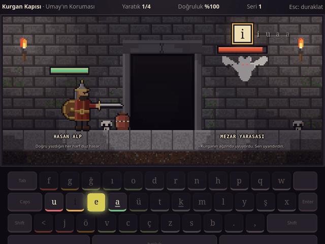
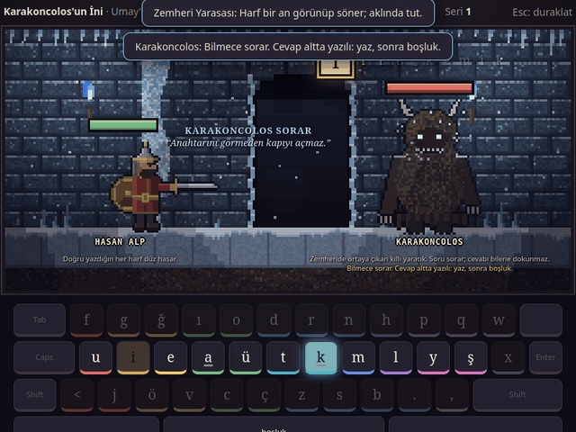

# Kurgan

Türk mitolojisi temalı, tarayıcıda oynanan bir **F klavye** on parmak oyunu.

**▶ Oyna:** https://hcakpolat.github.io/kurgan/

F klavye çalışmak ve bunu eğlenceli hale getirmek için bu oyunu **Claude** ile birlikte yaptım.

## Nasıl oynanır

Hasan Alp, atası Kara Alp'in kılıcını aramak için kurganlara iner. Yaratıkları doğru harfleri yazarak yenersin. Her oda birkaç yeni tuş öğretir. Geçmek için en az %95 doğruluk gerekir, hız sonra gelir.

- **Zindanlar:** Kurgan Kapısı → Taş Koridorlar → Zemheri Mağarası → Karakoncolos'un İni
- **Alkış:** odaya girmeden Ülgen'in Işığı, Börü Ruhu ya da Umay'ın Koruması'nı seç
- **Günlük Sefer:** zayıf tuşların ve yanlış yazdığın kelimelerle her gün 5 dakika
- **Sınav Kapısı:** 2025 zabıt kâtibi uygulamalı sınavının 30 metniyle 3 dakikalık deneme
- **Hata Mezarlığı:** yanlış yazdığın kelimeler, 3 farklı gün temiz yazınca gömülür
- **Kara Alp'in kılıcı:** her zindan bir parça bırakır
- Bir de gizli bir oda var 🧁

## Başlamadan: klavyeyi F düzenine al

Oyun Türkçe **F** düzeniyle oynanır. Tuşların üstünde Q harfleri yazsa da sorun olmaz, çünkü ekrandaki klavye sana yolu gösterir.

- **Windows:** Ayarlar → Saat ve dil → Dil ve bölge → Türkçe → Dil seçenekleri → Klavye ekle → **Türkçe F**. Düzenler arasında `Win + Boşluk` ile geçilir.
- **macOS:** Sistem Ayarları → Klavye → Giriş Kaynakları → Düzenle → `+` → Türkçe → **Türkçe F**.
- **Linux (KDE/GNOME):** Klavye ayarları → Düzenler → Ekle → **Türkçe (F)**.

Oyun başlarken sol işaret parmağınla çıkıntılı tuşa basmanı ister. Düzen yanlışsa seni uyarır.

## Sürüm geçmişi

- **v0.1** (14 Ekim): Kurgan Kapısı, ilk dört yaratık
- **v0.1.1**: piksel sanat savaş sahnesi
- **v0.2**: Taş Koridorlar, gizli oda, yaratık mekanikleri, alkış seçimi
- **v0.3** (16 Ekim): Zemheri Mağarası ve Karakoncolos'un bilmeceleri
- **v0.4** (17 Ekim): Sınav Kapısı, sınav metinlerinden kelime odaları
- **v0.4.1–0.4.2** (20 Ekim): küçük ekran desteği, net grafiği, Hata Mezarlığı
- **v0.5–0.5.1** (20 Ekim): Günlük Sefer, Kara Alp'in kılıcı

## Sırada ne var

- **Dev Ocağı:** üst sıra, Tepegöz ile yüzleşme
- **Yılan Sarayı:** alt sıra, Şahmeran
- **Tamağ:** bütün harfler, Erlik Han ve kılıcın tamamlanması
- **Hayalet Alp:** kendi eski rekorunla yarış

## Hata ya da fikir

Bir şey bozuksa ya da aklına bir fikir geldiyse [buradan yaz](https://github.com/hcakpolat/kurgan/issues), okuyorum.

## Kayıt

İlerlemen yalnız kendi tarayıcında saklanır. Başka bir bilgisayarda ya da tarayıcıda baştan başlarsın. Oyunun içinden JSON yedeği alabilirsin.

Sürüm: v0.5.1
